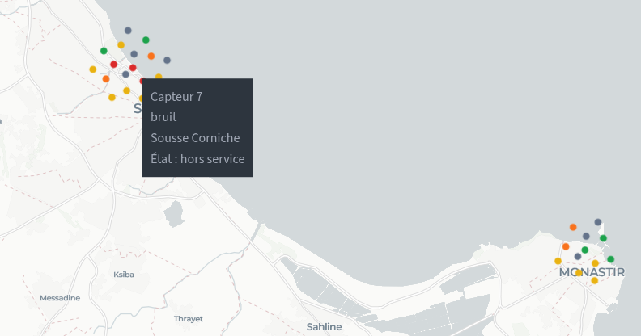

# Smart City — Tableau de bord de supervision

Projet académique de smart city prenant le gouvernorat de Sousse comme scénario de référence.
L'application Streamlit centralise le suivi des capteurs environnementaux, des mesures, des interventions
de maintenance, des citoyens et des véhicules dans un scénario de mobilité écologique.
La carte couvre aussi les autres villes tunisiennes présentes dans les données de démonstration.

Le projet associe une interface de supervision à un compilateur de requêtes françaises vers SQL,
des automates de validation des états et un générateur de rapports avec recommandations.
Les mesures et les véhicules sont des données de simulation ; l'application n'est pas reliée à des capteurs physiques.

## Fonctionnalités

| Onglet | Fonctionnement |
| --- | --- |
| Tables | Compteurs et aperçu des cinq tables de la base. |
| Carte des capteurs | Un point par capteur, couleur selon l'état, filtres, détails au survol et liste des localisations non reconnues. |
| Génération | Insertion d'un jeu de référence, génération en masse et création de mesures simulées. |
| NL → SQL | Compilation de requêtes en français, affichage du SQL et exécution sur la base. |
| Automates | Validation de séquences d'événements pour les capteurs, interventions et véhicules, avec visualisation des transitions et alertes simulées. |
| Rapports IA | Rapport en français et actions recommandées à partir des données courantes, avec génération locale ou fournisseur distant. |

Technologies : **Python, Streamlit, MySQL/MariaDB, pandas et Pydeck**. Le fond de carte est fourni par CARTO.

## Aperçu de la carte



Extrait de la carte : chaque point représente un capteur. Les capteurs partageant une localité sont
séparés visuellement ; leurs positions restent des estimations à partir du nom de la localité.

## Modèle de données

Les données sont stockées dans les tables suivantes :

- `citoyens(id_citoyen PK, nom, prenom, adresse, telephone)`
- `vehicule(id_vehicule PK, immatriculation, modele, etat_vehicule, date_mise_service)`
- `capteur(id_capteur PK, type_capteur, localisation, date_installation, etat_capteur, id_mesure FK)`
- `mesure(id_mesure, valeur, unite, type_mesure, horodatage)`
- `intervention(id_intervention PK, date_demande, date_debut, date_fin, statut_intervention, id_capteur FK)`

## Tests et compilateur français → SQL

Lancer les tests :

```bash
python -m unittest -v
```

Afficher les conversions des exemples :

```bash
python sql_compiler.py
```

Compiler un prompt personnalisé :

```bash
python sql_compiler.py "Montre les mesures où valeur > 50 et type_mesure = 'pollution'"
```

## Base MySQL

Le schéma MySQL est disponible dans [schema_mysql.sql](schema_mysql.sql).

Créer la base et les tables :

```bash
mysql -u root -p < schema_mysql.sql
```

Ce script crée la base `compcodex_db` avec :

- les 5 tables `citoyens`, `vehicule`, `capteur`, `mesure`, `intervention`
- les clés primaires et étrangères
- des index utiles pour les requêtes fréquentes du compilateur SQL
- des contraintes de domaine via `ENUM` pour `etat_capteur` et `etat_vehicule`

Valeurs autorisées :

- `etat_capteur`: `inactif`, `actif`, `signale`, `en maintenance`, `hors service`
- `etat_vehicule`: `stationne`, `en route`, `en panne`, `arrive`

## Interface Streamlit

Installer les dépendances :

```bash
pip install -r requirements.txt
```

Lancer l'interface :

```bash
streamlit run streamlit_app.py
```

## Simulation périodique des mesures

Le simulateur met à jour les mesures déjà liées aux capteurs, sans ajouter de nouvelles lignes à chaque cycle.
Les capteurs `hors service` sont ignorés. Exemple avec un intervalle d'une minute :

```bash
python sensor_simulator.py --user compcodex --password VOTRE_MOT_DE_PASSE --interval-minutes 1
```

L'intervalle par défaut est de 30 minutes. L'option `--iterations 1` permet d'exécuter un seul cycle.

## Carte des capteurs

L'onglet **Carte des capteurs** lit tous les capteurs de MySQL, sans la limite de l'aperçu des tables.
Le bouton **Actualiser la carte** recharge les états courants. Les filtres permettent de choisir les états affichés ;
le survol indique l'identifiant, le type, la localisation et l'état. La liste sous la carte conserve tous les capteurs,
y compris ceux d'une même localité. Chaque capteur est un point de 10 pixels ; les points partageant
les mêmes coordonnées sont séparés par un décalage visuel en pixels, sans modifier leurs coordonnées géographiques.

Couleurs : actif en vert, inactif en gris, signalé en jaune, en maintenance en orange, hors service en rouge
(état inconnu en violet).

## Rapports IA

Le module `ai_reports.py` analyse les capteurs, mesures, zones polluées et interventions ouvertes. Il produit un rapport en français et une liste d'actions prioritaires.

Par défaut, le rapport utilise Hugging Face Inference Providers avec Llama 3.1 via l'endpoint compatible OpenAI Chat Completions. Le token peut être placé dans `.env` :

```bash
lama_apikey="hf_..."
```

Variables équivalentes supportées : `HF_TOKEN`, `HUGGINGFACEHUB_API_TOKEN` ou `AI_REPORT_API_KEY`. Le modèle par défaut est `meta-llama/Llama-3.1-8B-Instruct:novita` et la base URL par défaut est `https://router.huggingface.co/v1`. Si l'appel distant échoue ou si aucun token n'est configuré, l'application revient automatiquement au générateur local.
